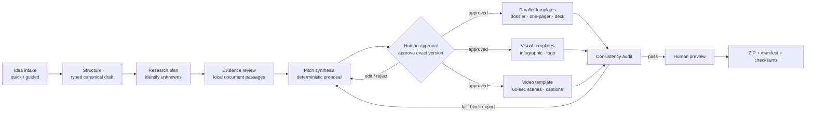

# Architecture and workflow

## Implemented vertical slice

`index.html` + `styles.css` + `app.js` form a dependency-free, local-first browser application. `localStorage` holds a project envelope and its evidence metadata. A plain-JavaScript structural validator guards state loaded from storage; the exported canonical object is specified by [pitch-source-of-truth.schema.json](../schema/pitch-source-of-truth.schema.json). The browser application does not call a model, remote API, MCP server, or package CDN.



The research-plan node is represented by the visible unknowns and proposed source-intake screen; no external research is executed. The work graph is deterministic UI state and functions, not an LLM-driven agent graph.

## State machine

| State | Entry condition | Allowed action | Next state |
|---|---|---|---|
| `INTAKE` | Empty or editable project | Save title + idea; import local source | `STRUCTURE` / `EVIDENCE_REVIEW` |
| `STRUCTURE` | Required intake provided | Build typed proposal draft | `EVIDENCE_REVIEW` |
| `EVIDENCE_REVIEW` | Draft or source passage available | Accept/reject a passage; inspect unknowns | `PITCH_REVIEW` |
| `PITCH_REVIEW` | Editable canonical draft | Edit fields, mark unknown, approve current version | `PITCH_REVIEW` / `ASSET_GENERATION` |
| `ASSET_GENERATION` | Exact model version approved | Generate deterministic outputs | `CONSISTENCY_AUDIT` |
| `CONSISTENCY_AUDIT` | Assets exist | Exact-field comparison | `HUMAN_PREVIEW` / block export |
| `HUMAN_PREVIEW` | Audit passed | Preview assets; download package | `EXPORT` |
| `EXPORT` | ZIP requested and audit passes | Download only; no publication | terminal for this package version |

An edit after approval resets approval, increments the model version on re-approval, and invalidates generated assets. No transition grants authorization to execute or publish the project.

## Canonical data contract

The JSON Schema in `schema/` defines the canonical record and its enumerated classifications, evidence provenance, brand brief, approval, and change log. The browser stores intake and approval metadata in a project envelope and writes the canonical model as `pitch-source-of-truth.json`. The schema uses standard JSON Schema draft 2020-12 and can be consumed by a future TypeScript/Zod or Python/Pydantic service.

Claim semantics:

- **FACT:** direct source support is recorded and reviewed; source quality still needs appraisal.
- **USER ASSERTION:** entered by the user, not independently confirmed.
- **ASSUMPTION:** provisional condition.
- **ESTIMATE:** numerical value with formula, units, values, and assumptions; no scenario is generated without adequate inputs.
- **HYPOTHESIS:** proposed effect requiring a test.
- **RECOMMENDATION:** proposed course, not a decision by an authority.
- **UNKNOWN:** information still to discover.

## Agent contracts for a production orchestration layer

The MVP intentionally has no generative agents. For a later governed implementation, add a coordinator only when each worker's input snapshot, tool permissions, output schema, and evaluation are independent and explicit:

| Worker | Input / scope | Output contract | Tools and guard |
|---|---|---|---|
| Intake structurer | Raw intake; preserve user intent | Typed candidate fields with classifications | No research, no final recommendation |
| Research planner | Unknowns and evidence ledger | Bounded query plan and allowlisted tool IDs | Cannot select arbitrary server/tool |
| Research worker | One approved query and source connector | Evidence records only, not pitch prose | Read-only, egress allowlist, logged |
| Source critic | Evidence records and linked claims | Authority/freshness/relevance/conflict review | Cannot elevate a claim without source |
| Product strategist | Approved source snapshot and evidence | Options, pilot, next step, typed recommendations | No new facts/metrics |
| Governance reviewer | Project model and defined policy questions | Review needs and open questions | Must not issue compliance/approval determination |
| Financial scenario worker | Adequate attributed inputs | Formula, units, source values, assumptions, scenario | No unsupported savings or cost claim |
| Story editor / generators | Immutable approved snapshot | Asset content plus claim/source IDs | Read-only snapshot; no source mutation |
| Consistency auditor | Source snapshot and all assets | Pass/fail findings with claim paths | Deterministic application code, not LLM-only |
| Export manager | Passed assets + approvals | Manifest, hashes, package | Deterministic names/checksums; no publication |

## Reference production deployment

- **Frontend:** Next.js/TypeScript accessible workspace, preview, source/status inspector.
- **API:** FastAPI or TypeScript service; schema validation at every boundary.
- **Data:** PostgreSQL project/version/evidence/approval metadata; encrypted object store for documents and outputs; per-project authorization.
- **Workflow:** LangGraph or another reviewed durable orchestrator; deterministic authorization, allowlisting, state transitions, retries, budget checks, and export remain application code.
- **Jobs/media:** bounded background queue; pluggable reviewed SVG/image and Remotion renderer; no renderer/provider activated without approval.
- **Observability:** per-node trace, source/tool audit, model/prompt versions, token/cost, evaluation, approvals, and asset history.
- **Operations:** enterprise identity and secret manager, encryption at rest/in transit, retention/deletion, egress controls, vulnerability/secret scans, incident response.

## Repository structure

```text
First/
├── index.html                         # Local-first accessible application shell
├── styles.css                         # Responsive UI; no runtime style dependency
├── app.js                              # Intake, state, templates, audit, ZIP export
├── schema/
│   └── pitch-source-of-truth.schema.json
├── examples/
│   └── qc1-demo.json                   # Seeded, unapproved canonical demonstration
├── docs/
│   ├── PRD.md
│   ├── ARCHITECTURE.md
│   ├── THREAT-MODEL.md
│   ├── MCP-ALLOWLIST.md
│   ├── UX-WIREFRAMES.md
│   └── ROADMAP.md
├── .env.example                        # Reserved deployment configuration; no secrets
└── README.md                           # Setup and operating limits
```
