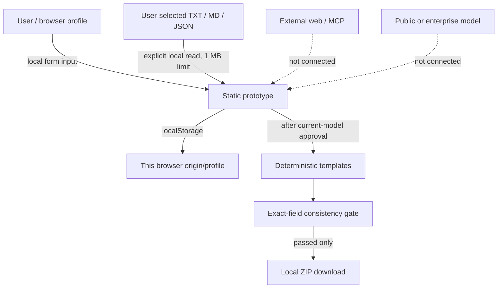

# Threat model and trust boundaries

## Assets and security objectives

Protect idea content, source passages, data classification, evidence references, approval records, generated assets, and exported provenance. Preserve confidentiality, integrity, reviewability, least privilege, and human control. This prototype keeps data in a browser profile but does **not** provide enterprise-grade confidentiality or access control.

## Trust boundaries

## Threat register

| Threat | Impact | Prototype controls | Residual risk / production treatment |
|---|---|---|---|
| Sensitive/confidential content entered on an unmanaged device | Data exposure via browser profile, backup, malware, shared account | Local-first disclosure; sensitivity selector; no network requests or server | Do not use with confidential/restricted data; use enterprise-managed deployment, encryption, identity, retention, and deletion |
| Prompt injection in imported document | Instructions could redirect a model or trigger a tool | No model or tools consume imported text; source is treated as data; passage is user-reviewed | Production connectors must isolate content, delimit quoted text, and test injection defenses |
| Malicious HTML/SVG in source passage | Script execution or preview compromise | Input rendered as text; HTML entities escaped in generated templates; imported markup not interpreted | Add sanitization and CSP if rich-document rendering is introduced |
| Cross-site scripting from stored project state | Script execution in same origin | Template fields escaped; persisted state has structural checks; no source HTML preview | Add full schema validation, CSP, and security testing; browser storage can be tampered with |
| Corrupted/tampered localStorage | Misleading project or provenance | Structural validation on load; clear-local-data option; approval gate; downloadable record visibly marked draft | Local client is not a trust anchor; backend signatures and authorization are required for regulated use |
| Stale approval after model edits | Assets generated against unreviewed content | Model edits revoke approval and discard generated assets; export re-runs audit | Add server-side optimistic version checks and immutable approval event records |
| Malicious or oversized file | Browser resource exhaustion | Only `.txt`, `.md`, `.json`; 1 MB cap; passage length limit; no archive/document parser | Server-side malware scanning, parser isolation, decompression limits, and content policies are required |
| SSRF or uncontrolled browsing | Access to internal services or data exfiltration | No web fetch, URL dereference, or MCP connection exists | Implement destination/egress allowlist, DNS/IP validation, redirects/timeouts/size limits, and per-tool scopes |
| ZIP path traversal or executable assets | Unsafe extraction | Fixed generated filenames; user text is not used as a path; ZIP entries are stored, not dynamically installed | Validate export names and scan downloads in production |
| False claims about compliance, savings, product approval, or production readiness | Sponsor decisions based on unsupported statements | Seeded demo marks hypotheses/unknowns; deterministic templates disclaim approval; no financial model | Add claim-to-evidence checks, source criticism, and human domain review |
| Unauthorized publication or mutation | Disclosure or operational effect | No publication, external mutation, or server tool is wired | Require explicit authorization and separate review for each privileged action |
| Dependency or supply-chain compromise | Code execution/data exfiltration | No runtime dependencies, CDN assets, GitHub installs, or network-loaded scripts | Pin reviewed releases, SBOM, SCA/secret scans, isolated tests, enterprise approval |

## Security invariants

1. An LLM is never the authorization or policy enforcement boundary.
2. Retrieved documents and metadata are untrusted data; embedded instructions cannot alter application policy.
3. Only the exact user-approved canonical version can generate final-format draft assets.
4. A consistency failure blocks export and never silently changes the canonical source.
5. No external transmission occurs in this demonstration.
6. Package approval is not project approval or authorization to share.

## Incident and retention posture

The local prototype has no centralized audit, remote deletion, backup control, or incident response integration. Clearing the project removes the localStorage key from the current origin/profile only; it cannot erase browser backups, OS snapshots, exported downloads, or copies. A production rollout must define retention, deletion propagation, export handling, incident ownership, and access logging with the enterprise data owner.
